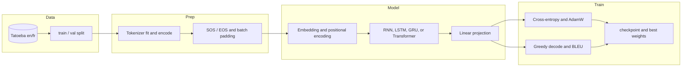

# Machine Translation in PyTorch

I built this to compare four encoder-decoder architectures and three tokenizers on the same English-French corpus, with the implementation kept small enough to read. The recurrent models (vanilla RNN, LSTM, GRU) and the Transformer share a training loop and a factory, so a run changes only `--model`, `--tokenizer`, and the shape flags. The word-level and BPE tokenizers are pure Python; SentencePiece supplies the unigram tokenizer. Every run writes its vocabulary, checkpoint, and per-epoch metrics to its own `artifacts/` directory. The vanilla RNN never learns to translate, while the word-level Transformer reaches 52.54 validation BLEU in the archived run.


_The four word-level runs from the results table. The Transformer reaches 52.54 at epoch 50; the RNN stays near zero._

## Contents

- [Results](#results)
- [Dataset](#dataset)
- [Requirements](#requirements)
- [Run it](#run-it)
- [Reproduce](#reproduce)
- [How it works](#how-it-works)
- [Project layout](#project-layout)
- [Configuration](#configuration)
- [Architecture search](#architecture-search)
- [Recorded samples](#recorded-samples)
- [Limits](#limits)
- [Stack](#stack)

## Results

BLEU numbers are corpus BLEU-4 from `torchmetrics.text.BLEUScore`, computed on the validation split and multiplied by 100. `src/trainer.py` evaluates after every epoch with greedy decoding capped at 50 tokens. Each row gives the highest BLEU the run logged, with the epoch in parentheses, and the lowest validation loss with its epoch.

| Model | Tokenizer | Vocabulary (src / tgt) | Best val BLEU (epoch) | Lowest val loss (epoch) | Run directory under `artifacts/` |
| --- | --- | --- | --- | --- | --- |
| RNN | basic | 11,426 / 15,000 | 1.11 (27) | 6.1792 (35) | `20260623_030156_rnn_emb128_hid256_lyr1` |
| LSTM | basic | 11,426 / 15,000 | 42.05 (50) | 3.3096 (47) | `20260623_044526_lstm_emb128_hid256_lyr2` |
| GRU | basic | 11,426 / 15,000 | 41.49 (45) | 3.3760 (38) | `20260623_065034_gru_emb128_hid512_lyr1` |
| Transformer | basic | 11,426 / 15,000 | 52.54 (50) | 2.0278 (21) | `20260622_234031_transformer_d512_h4_e4_d5` |
| LSTM | BPE | 15,000 / 15,000 | 40.17 (50) | 3.4212 (46) | `20260623_182322_lstm_emb512_hid256_lyr3` |
| LSTM | SPM | 2,048 / 2,048 | 32.16 (35) | 3.8654 (30) | `20260623_225636_lstm_emb256_hid512_lyr4` |
| Transformer | SPM | 2,048 / 2,048 | 46.27 (44) | 1.7883 (39) | `20260624_100125_transformer_d512_h8_e2_d4` |

`best_<model>.pth` is written when validation loss improves, not when BLEU improves, so the checkpoint corresponds to the lowest-loss epoch in the table. For the word-level Transformer that is epoch 21, not the epoch-50 model that logged 52.54; the epoch-50 weights were not kept. Every row has this mismatch. `checkpoint.pth` survives only for the three later runs in my directory.

Vocabulary size confounds the tokenizer comparison: the word-level and BPE runs used the older 15,000-piece cap, while the SentencePiece runs used 2,048. Today's CLI defaults to 2,048 for every tokenizer, so matching these columns requires passing the old caps. Vocabulary numbers are file lengths, not requested caps; the word-level source side stopped at 11,426 words because fewer words met `min_freq=2`.


_Tokenizer comparison for LSTM and Transformer. In these runs, the LSTM and Transformer both score higher with the word-level tokenizer than with SentencePiece, but the word-level and BPE vocabularies are 15,000 while the SentencePiece vocabularies are 2,048, so this is not an equal-vocabulary comparison._

## Dataset

This uses the English-French Tatoeba release packaged by [manythings.org/anki](http://www.manythings.org/anki/). `fra.txt` has 240,521 pairs. `tools.py --mode download` shuffles with `random.seed(42)`, keeps the first 10,000 pairs as validation, writes the rest as training, and leaves `fra.txt` and `_about.txt` in place. `src/dataset.py` then drops any pair where either side has more than 50 whitespace-separated tokens.

```bash
python tools.py --mode download
```

```text
[INFO] Downloading French-English dataset to dataset/tatoeba...
[INFO] Extracting...
[SUCCESS] Total pairs: 240521 | Train: 230521 | Val: 10000
```

```text
dataset/
└── tatoeba/
    ├── _about.txt
    ├── fra.txt
    ├── train.en
    ├── train.fr
    ├── val.en
    └── val.fr
```

`_about.txt` says the files are released under the Tatoeba terms, CC BY 2.0, with attribution to manythings.org and tatoeba.org. `dataset/` is gitignored; the splits are rebuilt by the download command.

## Requirements

- Python 3.10 or newer.
- `torch`, `torchmetrics`, `sentencepiece`, `optuna`, `torchinfo`, `tqdm`, and `matplotlib`. No dependency lockfile exists in the repository, so nothing is pinned.
- A CUDA GPU is optional. `main.py` falls back to CPU, but training the 50-epoch runs on CPU is not practical. The sanity check runs on CPU.
- About 51 MB for `dataset/tatoeba`. My local `artifacts/` directory takes 1.7 GB for the recorded runs; a fresh run needs space for two checkpoints and the vocabulary files.
- Linux. Paths are POSIX; I have not tested macOS or Windows.

## Run it

```bash
git clone https://github.com/abderrahmenex86/Machine-Translation-PyTorch.git
cd Machine-Translation-PyTorch
python3.12 -m venv venv
source venv/bin/activate
pip install torch torchmetrics sentencepiece optuna torchinfo tqdm matplotlib

python tools.py --mode download
python main.py --mode test --model transformer --tokenizer basic
```

`python3.12` is the version in the quickstart. If it is not installed, use any interpreter that satisfies the 3.10 floor.

`--mode test` builds a fresh model, runs one forward and backward pass, and exercises three greedy decode steps. It does not load a checkpoint or score a dataset. Expected tail on CPU:

```text
[INFO] Preparing dataset/tatoeba...

[INFO] Running Sanity Check for TRANSFORMER Architecture...

[TEST 1] Instantiating model and optimizers...
  -> Model instantiated successfully.

[TEST 2] Checking Training Forward and Backward Pass...
  -> Source Batch Shape: torch.Size([32, 15])
  -> Target Batch Shape: torch.Size([32, 17])
  -> Predictions Shape (Flattened): torch.Size([512, 2048])
  -> Targets Shape (Flattened): torch.Size([512])
  -> Loss calculated successfully: 7.8301
  -> Backward pass successful. Gradients updated.

[TEST 3] Checking Evaluation (Auto-Regressive Generation)...
  -> Generation logic executed correctly. Output shape: torch.Size([32, 4])

============================================================
[SUCCESS] All sanity checks passed! You are ready to run '--mode train'.
============================================================
```

Batch shapes and loss change with the sampled batch and initialization; the success block is the part to check. To exercise the SentencePiece path instead, run `python main.py --mode test --model transformer --tokenizer spm`; SentencePiece prints its trainer log before the block. To check the dataloader and target shift on the full split, run `python tools.py --mode verify --tokenizer bpe --vocab_size 2000`. BPE fitting is pure Python and runs over the full training split, so it is much slower than the 200-line sanity check.

## Reproduce

### Weights

No checkpoints are committed. `*.pth` is in `.gitignore`, and the repository has no release or model-hub link. Training writes `checkpoint.pth` (latest epoch) and `best_<model>.pth` (lowest validation loss) into `artifacts/<timestamp>_<config>/`. Inference needs that directory: `hyperparameters.json`, the two vocabulary files, and `best_<model>.pth`.

### Train

The word-level Transformer row has the highest BLEU. This command matches its shape flags and the 15,000-piece vocabulary cap used at the time:

```bash
python main.py --mode train --model transformer --tokenizer basic \
  --vocab_size 15000 --d_model 512 --nhead 4 --num_enc 4 --num_dec 5 \
  --dim_ff 2048 --batch_size 256 --epochs 50 --patience 50
```

`--patience 50` keeps the early stopper out of the way for the full 50 epochs. That run predates the current early-stopping code; with today's default `--patience 5` the same loss curve would stop at epoch 26. For the SentencePiece Transformer row:

```bash
python main.py --mode train --model transformer --tokenizer spm \
  --vocab_size 2048 --d_model 512 --nhead 8 --num_enc 2 --num_dec 4 \
  --dim_ff 2048 --batch_size 256 --epochs 50 --patience 5
```

No training seed is set. Model initialization and teacher-forcing draws use the default global RNGs, so neither command is bitwise reproducible. Training prints the run directory at the start; it contains `hyperparameters.json`, the vocabularies, `checkpoint.pth`, and the history. I did not record wall-clock time.

### Resume

```bash
python main.py --mode train --model transformer --tokenizer basic --resume
```

`--resume` picks the most recently modified directory under `artifacts/`, loads `checkpoint.pth`, and restores the optimizer, epoch, history, and early-stop counter. Pass the same `--model` and `--tokenizer` as the original run; a different tokenizer makes `main.py` look for a different vocabulary file and usually fail before training starts, and a different model changes the state-dict shapes. Use `--run_dir artifacts/<run>` to target a specific directory.

### Infer

```bash
python main.py --mode infer --model transformer \
  --run_dir artifacts/20260622_234031_transformer_d512_h4_e4_d5
```

```text
[INFO] Loaded Run: artifacts/20260622_234031_transformer_d512_h4_e4_d5
[INFO] Settings: Model=TRANSFORMER | Tokenizer=BASIC | Vocab=8000
[INFO] Interactive Mode | Type 'q' to quit.
============================================================
English > can you see me?
French  > peux tu me voir ?

English > Hello world
French  > bonjour .
```

`Vocab=8000` is a fallback, not the vocabulary size. Older `hyperparameters.json` files have no `vocab_size` key, and `src/infer.py` falls back to 8000 for the printed setting; the tokenizer is loaded from the saved `src_vocab_*` and `tgt_vocab_*` files. Those translations come from the epoch-21 checkpoint in that directory, not the epoch-50 model that logged 52.54.

No standalone evaluation command exists. BLEU is computed inside `src/trainer.py` after each epoch, so the only way to get a fresh BLEU number is to run training or add an evaluation loop around the saved tokenizer and model. `--mode test` is a sanity check, not an evaluation.

## How it works

Five stages make up the pipeline: prepare the corpus, fit a tokenizer, build the model, train with per-epoch validation, and decode greedily for inference. `main.py` is the CLI; `tools.py` handles data and verification.



**Corpus.** `tools.py --mode download` calls `src/helpers.download_dataset`. It downloads `fra-eng.zip`, extracts `fra.txt`, shuffles with seed 42, holds out 10,000 pairs, and writes the four split files. `src/dataset.load_data_lines` filters to 50 words per side and returns the train and validation lists.

**Tokenization.** `src/tokenizer.py` has three classes. `BasicTokenizer` lowercases, splits punctuation at `.`, `!`, and `?`, builds a frequency vocabulary with `min_freq=2`, and maps unseen words to `<UNK>`. `BPETokenizer` learns merges in pure Python and appends an end-of-word marker to each word. `SPMTokenizer` trains a SentencePiece unigram model with `character_coverage=0.9995`. Each class exposes `fit`, `encode`, `decode`, `save_vocab`, and `load_vocab`. `TranslationDataset` adds SOS and EOS around each sentence, and `PadCollate` pads each batch to its longest sequence.

**Model.** `src/factory.build_model` returns a `Seq2SeqRNN` for `rnn`, `lstm`, or `gru`, and a `Transformer` for `transformer`. The recurrent model embeds the source, runs the encoder once, then feeds the decoder one token at a time with teacher forcing. The Transformer scales embeddings by `sqrt(d_model)`, adds sinusoidal positional encoding, and uses `nn.Transformer` with a causal target mask and source, target, and memory padding masks.

**Training.** The training loop uses label-smoothed cross-entropy and AdamW, and clips gradients for the recurrent models. `evaluate` runs a greedy decode up to 50 tokens and computes corpus BLEU. After each epoch the trainer writes `checkpoint.pth`, updates `best_<model>.pth` on a new low validation loss, and stops after `--patience` epochs without improvement. The run history keeps train and validation loss, perplexity, and validation BLEU.

**Inference.** `src/infer.run_inference` reads `hyperparameters.json`, rebuilds the model and tokenizer from the run directory, loads `best_<model>.pth`, and loops on stdin. `--mode optimize` replaces the training loop with an Optuna study and writes `optuna_summary.json`.

Training runs in a single process without mixed precision, gradient accumulation, or a learning-rate schedule. A batch reaches the optimizer through `src/trainer.py`.

## Project layout

| Path | What it is |
| --- | --- |
| `main.py` | CLI for `train`, `test`, `optimize`, and `infer` |
| `tools.py` | CLI for dataset download, dataloader verification, and metric plots |
| `src/tokenizer.py` | `BasicTokenizer`, `BPETokenizer`, and `SPMTokenizer` |
| `src/dataset.py` | line loading, the 50-word filter, `TranslationDataset`, `PadCollate`, and `DataLoader` construction |
| `src/rnns.py` | shared encoder-decoder for RNN, LSTM, and GRU |
| `src/transformer.py` | Transformer and sinusoidal positional encoding |
| `src/factory.py` | model construction from CLI arguments or an Optuna trial |
| `src/trainer.py` | train and evaluate loops, checkpoints, and early stopping |
| `src/optimize.py` | Optuna study and `optuna_summary.json` |
| `src/infer.py` | interactive greedy translation |
| `src/tester.py` | forward, backward, and generation sanity checks |
| `src/verify.py` | dataloader and target-shift checks |
| `src/helpers.py` | dataset download and metric plots |
| `docs/samples.md` | recorded translations from an earlier sweep |
| `docs/figs/` | comparison charts |
| `dataset/` | downloaded data, gitignored |
| `artifacts/` | run outputs, gitignored |

## Configuration

`main.py` arguments:

| Flag | Default | What it does |
| --- | --- | --- |
| `--mode` | required | `train`, `test`, `optimize`, or `infer` |
| `--model` | required | `rnn`, `lstm`, `gru`, or `transformer` |
| `--dataset` | `dataset/tatoeba` | directory containing `train.en`, `train.fr`, `val.en`, and `val.fr` |
| `--tokenizer` | `basic` | `basic`, `bpe`, or `spm` |
| `--vocab_size` | `2048` | vocabulary cap passed to `fit(max_vocab=...)` |
| `--epochs` | `50` | maximum training epochs; optimize uses 3 per trial |
| `--batch_size` | `256` | batch size; `test` caps it at 32 |
| `--patience` | `5` | stop after this many epochs without a lower validation loss |
| `--resume` | off | load `checkpoint.pth` and the saved vocabulary |
| `--run_dir` | latest run | target directory for `--resume` and `infer`; a new training run ignores it |
| `--embed_size` | `256` | recurrent embedding width |
| `--hidden_size` | `512` | recurrent hidden width |
| `--num_layers` | `2` | recurrent layers |
| `--d_model` | `256` | Transformer width |
| `--nhead` | `8` | Transformer attention heads |
| `--num_enc` | `3` | Transformer encoder layers |
| `--num_dec` | `3` | Transformer decoder layers |
| `--dim_ff` | `1024` | Transformer feed-forward width |

`tools.py` arguments:

| Flag | Default | What it does |
| --- | --- | --- |
| `--mode` | required | `download`, `verify`, or `plot` |
| `--model` | `all` | `all` or one architecture; used by `plot` |
| `--dataset` | `dataset/tatoeba` | data directory |
| `--tokenizer` | `basic` | tokenizer used by `verify` |
| `--run_dir` | latest run | run directory used by `plot` |

Fixed training settings:

| Setting | Value |
| --- | --- |
| Optimizer | AdamW |
| Learning rate | `1e-4` for Transformer, `5e-3` for recurrent |
| Weight decay | `1e-4` for Transformer, `1e-2` for recurrent |
| Loss | cross-entropy with `label_smoothing=0.1` and `ignore_index=PAD` |
| Gradient clipping | `1.0`, recurrent models only |
| Teacher forcing | `0.5` during training, `0` during evaluation, recurrent models only |
| Maximum decode length | 50 tokens |
| Checkpoint | every epoch to `checkpoint.pth` |
| Best weights | `best_<model>.pth` on a new low validation loss |
| History | `<model>_history.json` with train and validation loss, perplexity, and validation BLEU |
| Early stopping | validation loss, patience `--patience` |

Files inside a run directory:

| File | Contents |
| --- | --- |
| `hyperparameters.json` | `vars(args)` at the start of the run |
| `src_vocab_<tokenizer>.json` or `.model` | source vocabulary; SPM uses `.model` |
| `tgt_vocab_<tokenizer>.json` or `.model` | target vocabulary |
| `checkpoint.pth` | model, optimizer, epoch, best loss, history, and early-stop counter |
| `best_<model>.pth` | model state at the lowest validation loss |
| `<model>_history.json` | per-epoch train and validation loss, perplexity, and validation BLEU |
| `architecture.txt` | `torchinfo` summary, if generation succeeded |
| `optuna_summary.json` | best trial, best parameters, and all trials, for `optimize` only |

## Architecture search

`--mode optimize` runs an Optuna study with 15 trials per invocation, 3 epochs per trial, a median pruner, and a reduced corpus: 10,000 training pairs and 1,000 validation pairs. Only model shape varies; the learning rate and loss stay fixed. Results go to `artifacts/<run>/optuna_summary.json`.


_Fifteen trials per search. Lowest validation losses were 5.20 for LSTM basic, 4.67 for GRU basic, 5.86 for LSTM BPE, and 5.61 for LSTM SPM. These are 3-epoch losses on the 10k/1k subset and are not comparable to the 50-epoch training losses._


_Left: LSTM trials grouped by embedding size; the three medians sit between 5.6 and 5.7 with overlapping boxes. Right: Transformer trials grouped by `d_model`; the 512 group has the lowest median loss in this search. With 15 trials and 3 epochs per model, the ordering is not a reliable ranking._

The word-level Transformer run uses `d_model 512`, `nhead 4`, `num_enc 4`, `num_dec 5`, and `dim_ff 2048`, which matches the best Transformer trial. Other run directories record the shape flags that were used; not every one matches its search's best trial, and `hyperparameters.json` is the authority for a given run.

## Recorded samples

[`docs/samples.md`](docs/samples.md) records four prompts through seven model and tokenizer combinations from an earlier sweep. `docs/samples.md` prints `Vocab=8000` in its header; that is the fallback in `src/infer.py` for run files without a `vocab_size` key, not a measurement of the saved vocabulary. These outputs are not from the archived 50-epoch runs.

```text
Settings: Model=RNN | Tokenizer=BASIC | Vocab=8000

English > can you see me?
French  > je ne que pas .
```

```text
Settings: Model=TRANSFORMER | Tokenizer=SPM | Vocab=8000

English > i don't know why
French  > je ne sais pas pourquoi je suis au courant.
```

The RNN repeats one sentence for every prompt. The BPE LSTM emits subword pieces (`peu t m voi`) instead of words. The SentencePiece Transformer produces grammatical French, but it also over-translates: `i don't know why` becomes "I don't know why I am aware of it." None of these models is usable outside the study.

## Limits

- No held-out test split exists. This 10,000-pair validation split is also the split used for early stopping and checkpoint selection, so the BLEU numbers are optimistic and do not estimate performance on unseen data.
- The saved checkpoint tracks validation loss, so `best_<model>.pth` can be an earlier epoch than the BLEU peak. The word-level Transformer shows the largest gap: 52.54 at epoch 50, checkpoint at epoch 21. Inference uses the epoch-21 weights.
- Vocabulary size confounds the tokenizer comparison. Word-level and BPE used 15,000; SPM used 2,048. Today's default is 2,048 for all three. I did not rerun the sweep at equal vocabulary.
- The archived runs predate two current defaults: `--vocab_size` and early stopping were added on June 23 and 24, 2026. The archive mixes runs from before and after. Fresh runs with today's defaults will not match the table exactly.
- No training seed is set. Model initialization and teacher-forcing draws use the default global RNGs, so two runs with the same flags will diverge.
- Decoding is greedy only. There is no beam search, length penalty, or repetition penalty, and the hard 50-token cap can truncate long sentences.
- `BasicTokenizer` lowercases, splits punctuation only at `.`, `!`, and `?`, drops other characters, and maps unseen words to `<UNK>`. Case and most punctuation are lost before the model sees the sentence.
- `BPETokenizer.decode` joins pieces without a word-boundary space except after the end-of-word marker, so some outputs read as fragments. The samples show this.
- The vanilla RNN does not learn: its best validation BLEU was 1.11, its final epoch was 0.00, and the earlier samples show it repeating `je ne que pas .`.
- Tatoeba is mostly short, everyday sentences, many of them formulaic. BLEU does not transfer to news, technical text, or long documents, and the 50-word filter removes the longest pairs.
- Training uses batch size 256 in a single process, without mixed precision or gradient accumulation. If you hit an out-of-memory error, lower `--batch_size`; I did not record a minimum VRAM figure or wall-clock time.
- `--mode test` is a shape and gradient check on a 200-pair training subset. It builds a fresh model; it does not load or score a checkpoint.
- `SPMTokenizer.fit` writes a temporary `spm_tmp_<id>.model` file in the working directory. Training removes it when it saves the vocabulary; `--mode test` leaves it behind.
- No weights are distributed. You need to train a run before `--mode infer` will work.

## Stack

| Component | Role | Version |
| --- | --- | --- |
| Python | runtime | 3.10 or newer |
| PyTorch | models, training, checkpoints | not pinned |
| torchmetrics | corpus BLEU | not pinned |
| SentencePiece | unigram tokenizer | not pinned |
| Optuna | architecture search | not pinned |
| torchinfo | architecture summary | not pinned |
| tqdm | progress bars | not pinned |
| Matplotlib | metric plots | not pinned |
